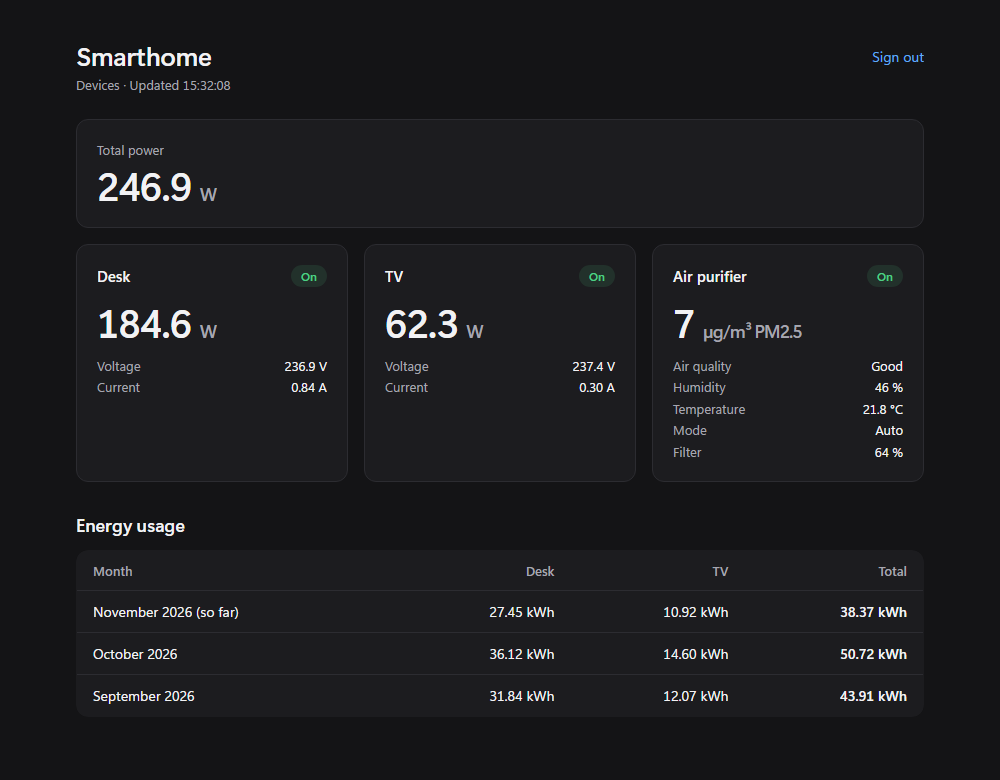
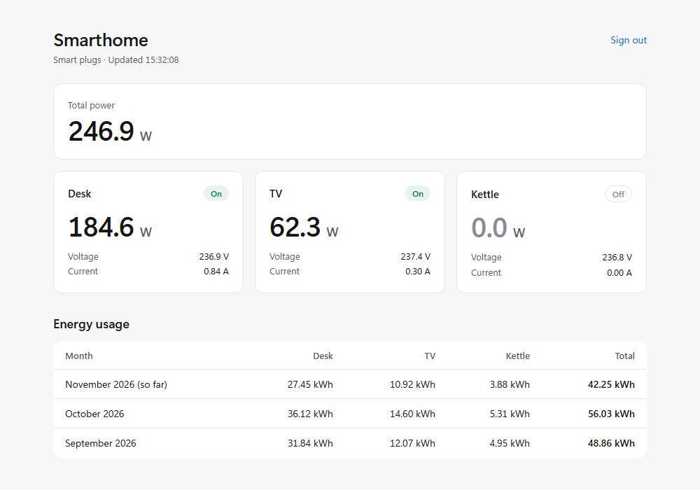
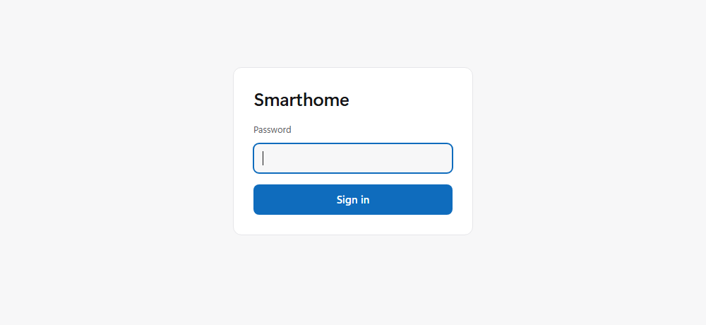
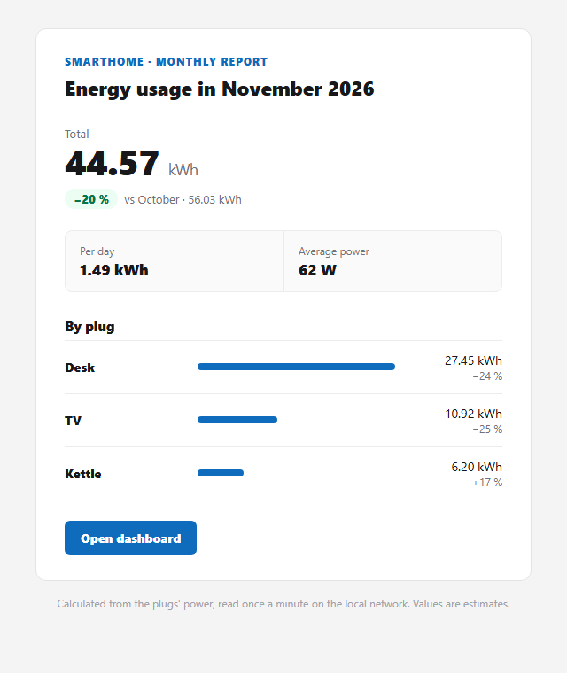

# Smarthome

A small read-only dashboard for Wi-Fi smart plugs built on Tuya (Smart Life, Hombli and many others). It reads the plugs directly over your local network, with no cloud and no Home Assistant, and shows:

- on/off state, power (W), voltage (V) and current (A) for every plug, refreshed every 5 seconds
- total power of all plugs
- energy usage in kWh per plug and month, with the last 13 months listed
- optionally, a monthly usage report by email

It never switches a plug. The code only sends status queries.







## Requirements

- A web server with **PHP 8.1+** (with the bundled `openssl` extension) that sits in the **same network as the plugs**. The plugs only answer on the LAN (TCP port 6668).
- Cron on that server, if you want the kWh counter.
- Plugs that speak Tuya local protocol **3.3**. Most Wi-Fi plugs that work in Smart Life do. Plugs with 3.4/3.5 firmware are not supported.
- Once, for setup: Python 3 and a free Tuya developer account to get each plug's local key.

## Setup

### 1. Put the plugs into the Smart Life app

The local key can only be read through a Tuya cloud project, and that project can only be linked to the **Smart Life** (or Tuya Smart) app. If your plugs are in a brand app such as Hombli, remove them there and add them in Smart Life (publisher *Volcano Technology Limited*). Your phone must be on 2.4 GHz Wi-Fi while pairing.

Re-pairing a plug gives it a new local key, so do this before step 3.

### 2. Create a Tuya cloud project

1. Sign up at [platform.tuya.com](https://platform.tuya.com).
2. **Cloud → Development → Create Cloud Project**
   - Development Method: **Smart Home**
   - Data Center: the one your Smart Life account lives in (Europe: **Central Europe**)

   Choose the data center right away. Changing it on an existing project can leave it broken with error `28841107 … data center is suspended`. In that case, create a new project.
3. In the project: **Devices → Link App Account → Add App Account → Tuya App Account Authorization**. Scan the QR code with Smart Life (*Me* → scan icon top right). Choose *Automatic Link* and *Read Only*.
4. Both plugs should now be listed under **All Devices**. The project's **Overview** tab has the **Access ID** and **Access Secret**.

### 3. Get the local keys

```sh
pip install tinytuya
python -m tinytuya wizard
```

Enter the Access ID, Access Secret, the ID of any of your devices and the region (`eu`, `us`, …). The wizard writes `devices.json` with `id` and `key` for every plug.

After this you no longer need the cloud project. The local keys stay valid until a plug is paired again.

### 4. Configure

```sh
cp config.example.php config.php
php -r "echo password_hash('your password', PASSWORD_DEFAULT), PHP_EOL;"
```

In `config.php`, set `PAGE_PASSWORD_HASH` to that hash. Then add one entry to `PLUGS` per plug, with a name of your choice, the IP address, and `id` and `key` from `devices.json`.

Give every plug a **fixed DHCP lease** in your router, otherwise the IP changes and the plug shows as offline.

### 5. Deploy

Copy the folder to your web server, for example as `/smarthome`. The bundled `.htaccess` (Apache) does this:

- blocks `config.php`, `tuya.php`, `auth.php`, `counter.php`, `report.php`, `mail.php` and `data/`
- sets a strict Content Security Policy
- turns off `DirectorySlash`. Behind a reverse proxy, Apache would otherwise redirect `/smarthome` to an `http://` URL. With it off, `/smarthome` (no slash) needs a rewrite in the parent `.htaccess`:

  ```apache
  RewriteRule ^smarthome/?$ smarthome/index.php [L,QSA]
  ```

  On a plain setup you can remove the `DirectorySlash Off` line instead.

On nginx, deny the same files yourself. The session cookie is `Secure`, so serve the page over HTTPS.

### 6. Start the kWh counter

The plugs report power but keep no energy total, so `counter.php` reads every plug once a minute and adds up kWh per month in `data/usage.json`. Add it to the crontab of the web server user:

```sh
sudo crontab -u www-data -e
```

```cron
* * * * * php /var/www/smarthome/counter.php
```

The user running the cron job must be able to write to `data/`. The first numbers appear after two minutes.

### 7. Monthly report by email (optional)

`report.php` mails the usage of the previous month: the total, the change against the month before, the average per day and in watts, and a breakdown per plug. The mail has an HTML version and a plain-text fallback.



It sends through an SMTP mailbox. Put the mailbox login in a file **outside the web root** that the cron user can read:

```sh
sudo mkdir -p /etc/smarthome
sudo nano /etc/smarthome/mail.php
```

```php
<?php return ['user' => 'sender@example.com', 'pass' => '...', 'smtp' => 'ssl://smtp.example.com:465'];
```

```sh
sudo chown root:www-data /etc/smarthome/mail.php
sudo chmod 640 /etc/smarthome/mail.php
```

`smtp` is optional and defaults to IONOS (`ssl://smtp.ionos.de:465`). Set `MAIL_ACCOUNT`, `MAIL_TO` and, optionally, `DASHBOARD_URL` in `config.php`. Check the text with a dry run, send one real mail, then add the cron job:

```sh
sudo -u www-data php /var/www/smarthome/report.php --dry-run          # text version
sudo -u www-data php /var/www/smarthome/report.php --dry-run --html   # HTML version
sudo -u www-data php /var/www/smarthome/report.php --month=2026-11
```

```cron
0 7 1 * * php /var/www/smarthome/report.php
```

## How it works

| File | Purpose |
|---|---|
| `tuya.php` | Minimal Tuya 3.3 client: sends an encrypted `DP_QUERY` to port 6668 and decrypts the reply (AES-128-ECB with the local key) |
| `api.php` | JSON for the page: current values of all plugs plus monthly usage. Readings are cached for 4 s, because the plugs handle parallel connections badly. |
| `counter.php` | Cron job for the kWh counter (CLI only) |
| `report.php`, `mail.php` | Monthly report and a minimal SMTP client (CLI only) |
| `index.php`, `app.js`, `style.css` | Page and sign-in |
| `auth.php` | Session check |

Data points used: `1` on/off, `18` current in mA, `19` power in W×10, `20` voltage in V×10. A plug with a different mapping shows wrong values. In that case, check the raw data points with `tinytuya` and adjust `plug_values()` in `tuya.php`.

### Accuracy of the counter

Energy is the average power between two readings times the time in between. With one reading per minute this is close to the plug's own app for steady loads. Short spikes between readings are missed.

The counter also records how long it actually measured each month. The report's daily and average-power figures use that time, so a month where the counter started late still shows realistic averages.

Gaps longer than 10 minutes (server or plug offline) are not counted, because the usage during the gap is unknown. The monthly total is then a bit low.

## License

MIT
